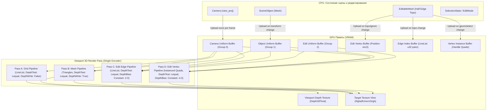
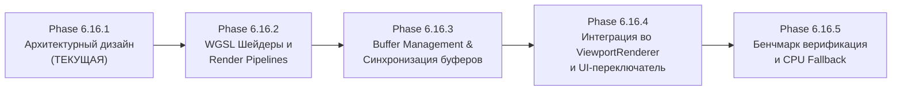

# Forge3D Rust Edition — GPU Edit Mode Pipeline Architecture Design

**Статус документа**: Спроектировано (Architectural Design)  
**Фаза проекта**: Phase 6.16.1  
**Дата**: Ноябрь 2026 г.  
**Целевая подсистема**: `crates/forge-render` (`ViewportRenderer`), `crates/forge-gpu`, `apps/forge3d-studio` (`viewport.rs`)

---

## 1. Введение и предпосылки

В фазе Phase 6.15.5 и итоговом бенчмарке Phase 6.15.6 было исследовано и оптимизировано отображение сетки в режиме редактирования (**Edit Mode**) через CPU-кэширование [`EditOverlayCache`](file:///home/dropt1m/Forge3D%20Rust%20Edition/apps/forge3d-studio/src/ui/viewport.rs#L1592) и объединение вызовов в пакетный `egui::Mesh`.

Несмотря на снижение стоимости отрисовки статичного кадра до **6.9 мс** при 100k вершин, бенчмарк выявил ключевое архитектурное ограничение CPU-подхода:

> [!WARNING]
> При интерактивном перемещении камеры (вращение Orbit, панорамирование Pan, масштабирование Zoom) изменение матрицы `view_proj` делает кэш 2D-координат невалидным. Процессор вынужден на лету заново выполнять перспективное деление для 100 000 вершин и генерировать ~1.6 млн вершин и ~2.4 млн индексов в `egui::Mesh`, что занимает **~142–165 мс** на кадр (~6.5–7 FPS).

Настоящий документ описывает архитектуру переноса отрисовки wireframe-рёбер и вершинных манипуляторов Edit Mode непосредственно на **GPU Pipeline** средствами `wgpu`.

---

## 2. Архитектурная схема (Data Flow & Pipeline Pass Sequence)

Edit Mode GPU Pipeline интегрируется в общий цикл рендеринга [`ViewportRenderer::render()`](file:///home/dropt1m/Forge3D%20Rust%20Edition/crates/forge-render/src/renderer.rs#L127) в качестве дополнительных проходов (**Pass C** и **Pass D**), разделяющих существующий буфер глубины (`depth_view`) с основным мешем.



### Последовательность выполнения проходов:
1. **Pass A (Сетка координат)**: Отрисовка координатной сетки `grid_pipeline` без записи глубины.
2. **Pass B (Сплошной 3D Меш)**: Отрисовка базовой геометрии редактируемого объекта через `mesh_pipeline` с записью в буфер глубины (`Depth32Float`).
3. **Pass C (GPU Wireframe Edges)**: Отрисовка рёбер топологии поверх сплошного меша через `edit_edge_pipeline` с топологией `LineList` и небольшим отрицательным Depth Bias (предотвращает Z-fighting со сплошным мешем).
4. **Pass D (GPU Vertex Handles)**: Отрисовка вершинных манипуляторов через `edit_vertex_pipeline` с использованием **Instanced Quads** (билбординг в экранных пикселях) и ещё большим смещением глубины в сторону камеры.

---

## 3. Аудит текущего рендерера и переиспользуемые компоненты

| Компонент | Текущее назначение | Статус переиспользования в GPU Edit Mode |
|---|---|---|
| [`GpuContext`](file:///home/dropt1m/Forge3D%20Rust%20Edition/crates/forge-gpu/src/context.rs) | Инициализация `wgpu::Device`, `wgpu::Queue`, опрос возможностей адаптера | **100% переиспользуется**. Создание новых пайплайнов и буферов через существующий контекст. |
| [`ViewportRenderer`](file:///home/dropt1m/Forge3D%20Rust%20Edition/crates/forge-render/src/renderer.rs#L36) | Главный цикл рендеринга вьюпорта, command encoder, depth texture management | **Расширяется**. В структуру добавляются пайплайны Edit Mode и кэш буферов активного меша. |
| [`CameraUniform`](file:///home/dropt1m/Forge3D%20Rust%20Edition/crates/forge-render/src/uniforms.rs#L7) (Group 0) | Матрица `view_proj` и позиция камеры `camera_pos` | **100% переиспользуется**. Шейдеры Edit Mode используют тот же `camera_bind_group` без модификаций. |
| [`ObjectUniform`](file:///home/dropt1m/Forge3D%20Rust%20Edition/crates/forge-render/src/uniforms.rs#L24) (Group 1) | Модельная матрица объекта `model`, цвет, флаг выделения | **100% переиспользуется**. Обеспечивает корректное преобразование локальных координат в мировые. |
| [`GpuBuffer<T>`](file:///home/dropt1m/Forge3D%20Rust%20Edition/crates/forge-gpu/src/buffer.rs) | Типобезопасная обёртка над `wgpu::Buffer` с отслеживанием размера и типа | **100% переиспользуется** для вершинных, индексных и инстанс-буферов. |
| [`RenderStats`](file:///home/dropt1m/Forge3D%20Rust%20Edition/crates/forge-render/src/renderer.rs#L25) | Счётчики загрузок и реаллокаций буферов | **Расширяется** полями `edit_edge_draws`, `edit_vertex_draws`. |

---

## 4. Проектирование GPU Wireframe & Vertex Pipelines

### 4.1. Отрисовка рёбер: LineList vs Screen-space Quads

Были исследованы два основных подхода:
1. **Screen-space Quads (Thick Lines)**: Каждое ребро разворачивается в 2 треугольника (4 вершины) в экранном пространстве.
   - *Плюсы*: произвольная толщина линии в пикселях.
   - *Минусы*: четырёхкратный оверхед по памяти вершин, сложный шейдер соединения стыков, неэффективно для сеток > 50k.
2. **Native LineList (`wgpu::PrimitiveTopology::LineList`)**:
   - Использует стандартный индексный буфер пар вершин `[v0, v1, v0, v1]`.
   - *Плюсы*: минимальный размер данных (всего 8 байт на ребро), нулевая тесселяция на CPU, аппаратная растеризация, стандарт для CAD/Blender.
   - *Минусы*: фиксированная ширина 1 пиксель в современных API (Vulkan/Metal/DX12). Для 3D-моделирования 1px является золотым стандартом точности.

> [!TIP]
> **Решение**: Выбран подход **`PrimitiveTopology::LineList`**. Он обеспечивает максимальную скорость (растеризация 200k рёбер занимает < 0.2 мс на GPU) и минимальный расход VRAM (всего 1.6 МБ на 200k рёбер).

### 4.2. Отрисовка вершинных манипуляторов: почему Instanced Quads?

В спецификации WebGPU (`wgpu`) примитив `PrimitiveTopology::PointList` **не поддерживает `gl_PointSize`** — точки аппаратно всегда рисуются размером строго 1x1 пиксель. На 2K/4K дисплеях точки в 1 пиксель неразличимы для пользователя.

**Решение**: **Instanced Quads (Билбординг)**:
- Статический базовый буфер: 1 квадрат из 4 вершин и 6 индексов с координатами в диапазоне `[-1.0, 1.0]`.
- Инстанс-буфер: одна запись на каждую вершину меша (`position: vec3<f32>`, `flags: u32`).
- Вершинный шейдер проецирует центр вершины в клип-пространство через `camera.view_proj * object.model * vec4(position, 1.0)`, а затем смещает 4 угла квадрата на фиксированное количество **экранных пикселей** с учетом размера вьюпорта (`viewport_size`).
- Фрагментный шейдер отрисовывает антиалиасинг, контрастную рамку и цвет в зависимости от состояния выделения.

---

## 5. Архитектура GPU-буферов и стратегии обновления

### 5.1. Форматы буферов

#### 1. Статический буфер позиций вершин (`EditVertexBuffer`)
Содержит только позиции вершин редактируемого меша в локальном пространстве:
```rust
#[repr(C)]
#[derive(Copy, Clone, Debug, bytemuck::Pod, bytemuck::Zeroable)]
pub struct EditVertexGpu {
    pub position: [f32; 3], // 12 байт (локальные координаты)
}
```
*Размер для 100k вершин*: $100\,489 \times 12\text{ байт} \approx \mathbf{1.20\text{ МБ}}$.

#### 2. Индексные буферы рёбер (`EdgeIndexBuffer`)
Хранят пары индексов вершин, образующих рёбра. Для минимизации логики шейдера индексы разделяются на два непрерывных диапазона или два буфера:
- `unselected_edge_indices`: рёбра базового каркаса (серый цвет).
- `selected_edge_indices`: выделенные рёбра (ярко-оранжевый цвет).
```rust
// Индексы Uint32: [v0, v1, v2, v3, ...]
```
*Размер для 200k рёбер*: $200\,000 \times 2 \times 4\text{ байт} \approx \mathbf{1.60\text{ МБ}}$.

#### 3. Инстанс-буфер вершин (`VertexInstanceBuffer`)
Содержит состояние каждой вершины для манипуляторов:
```rust
#[repr(C)]
#[derive(Copy, Clone, Debug, bytemuck::Pod, bytemuck::Zeroable)]
pub struct VertexHandleInstanceGpu {
    pub position: [f32; 3], // 12 байт
    pub state_flags: u32,   // 4 байта: 0 = unselected, 1 = selected, 2 = hovered
}
```
*Размер для 100k вершин*: $100\,489 \times 16\text{ байт} \approx \mathbf{1.61\text{ МБ}}$.

#### 4. Юниформ-буфер Edit Mode (`EditModeUniform`, Group 2)
```rust
#[repr(C)]
#[derive(Copy, Clone, Debug, bytemuck::Pod, bytemuck::Zeroable)]
pub struct EditModeUniform {
    pub viewport_size: [f32; 2],  // 8 байт (ширина, высота вьюпорта в пикселях)
    pub vertex_point_size: f32,   // 4 байта (размер точки, например 5.0 px)
    pub selection_mode: u32,      // 4 байта (0 = Vertex, 1 = Edge, 2 = Face)
}
```

### 5.2. Частота и стратегия обновления буферов

| Событие | Позиции (`EditVertexBuffer`) | Рёбра (`EdgeIndexBuffer`) | Инстансы вершин (`VertexInstanceBuffer`) | Юниформы камеры/объекта | Нагрузка на CPU / шину PCIe |
|---|:---:|:---:|:---:|:---:|:---:|
| **Движение камеры (Orbit/Pan/Zoom)** | **0 байт (Без изменений)** | **0 байт (Без изменений)** | **0 байт (Без изменений)** | 128 байт (`CameraUniform`) | **< 0.01 мс** (FPS > 120) |
| **Смена выделения (Selection)** | 0 байт | Перезапись смещений | Перезапись `state_flags` (~400 КБ) | 0 байт | **< 1.0 мс** |
| **Трансформация объекта (G/R/S)** | 0 байт | 0 байт | 0 байт | 256 байт (`ObjectUniform`) | **< 0.01 мс** |
| **Деформация геометрии (Edit Move)** | Обновление позиций (1.2 МБ) | 0 байт | Обновление позиций (1.6 МБ) | 0 байт | **~1.5 мс** |
| **Изменение топологии (Extrude/Subdiv)** | Полная реаллокация | Полная реаллокация | Полная реаллокация | 0 байт | **~3–5 мс** (только при операции) |

---

## 6. Структура WGSL Шейдеров

### 6.1. Шейдер рёбер каркаса (`edit_edge.wgsl`)

```wgsl
struct CameraUniform {
    view_proj: mat4x4<f32>,
    camera_pos: vec4<f32>,
};

struct ObjectUniform {
    model: mat4x4<f32>,
    color: vec4<f32>,
    is_selected: u32,
    _pad0: u32,
    _pad1: u32,
    _pad2: u32,
};

struct EditUniform {
    viewport_size: vec2<f32>,
    vertex_point_size: f32,
    selection_mode: u32,
};

@group(0) @binding(0) var<uniform> camera: CameraUniform;
@group(1) @binding(0) var<uniform> object: ObjectUniform;
@group(2) @binding(0) var<uniform> edit_cfg: EditUniform;

struct VertexInput {
    @location(0) position: vec3<f32>,
};

struct VertexOutput {
    @builtin(position) clip_position: vec4<f32>,
};

@vertex
fn vs_edge(input: VertexInput) -> VertexOutput {
    var out: VertexOutput;
    let world_pos = object.model * vec4<f32>(input.position, 1.0);
    var clip = camera.view_proj * world_pos;
    
    // Depth bias: легкое смещение глубины в сторону ближней плоскости для устранения Z-fighting со сплошным мешем
    clip.z = clip.z - 0.00015 * clip.w;
    
    out.clip_position = clip;
    return out;
}

@fragment
fn fs_edge_unselected() -> @location(0) vec4<f32> {
    // Полупрозрачный стальной цвет невыделенных рёбер (#788296, alpha 0.65)
    return vec4<f32>(0.47, 0.51, 0.59, 0.65);
}

@fragment
fn fs_edge_selected() -> @location(0) vec4<f32> {
    // Яркий оранжевый цвет выделенных рёбер (#FFAA28, alpha 1.0)
    return vec4<f32>(1.0, 0.667, 0.157, 1.0);
}
```

### 6.2. Шейдер вершинных манипуляторов (`edit_vertex.wgsl`)

```wgsl
// Базовый квад билборда [-1..1]
struct QuadVertexInput {
    @location(0) quad_pos: vec2<f32>,
};

// Инстанс вершины меша
struct InstanceInput {
    @location(1) center_pos: vec3<f32>,
    @location(2) flags: u32,
};

struct VertexOutput {
    @builtin(position) clip_position: vec4<f32>,
    @location(0) uv: vec2<f32>,
    @location(1) @interpolate(flat) flags: u32,
};

@vertex
fn vs_vertex_handle(quad: QuadVertexInput, instance: InstanceInput) -> VertexOutput {
    var out: VertexOutput;
    
    // 1. Проецируем центр вершины в clip space
    let world_center = object.model * vec4<f32>(instance.center_pos, 1.0);
    let clip_center = camera.view_proj * world_center;
    
    // 2. Вычисляем пиксельное смещение в нормализованных координатах (NDC)
    // 2.0 / viewport_size переводит пиксели в диапазон NDC [-1..1]
    let pixel_scale = 2.0 / edit_cfg.viewport_size;
    let radius_px = edit_cfg.vertex_point_size * 0.5;
    let offset_ndc = quad.quad_pos * radius_px * pixel_scale;
    
    // 3. Добавляем смещение с учетом перспективного деления (* clip_center.w)
    var final_clip = clip_center;
    final_clip.x = final_clip.x + offset_ndc.x * clip_center.w;
    final_clip.y = final_clip.y + offset_ndc.y * clip_center.w;
    
    // Смещение по Z вперед (вершины всегда рисуются поверх рёбер и граней)
    final_clip.z = final_clip.z - 0.00035 * clip_center.w;
    
    out.clip_position = final_clip;
    out.uv = quad.quad_pos;
    out.flags = instance.flags;
    return out;
}

@fragment
fn fs_vertex_handle(in: VertexOutput) -> @location(0) vec4<f32> {
    // Квадратный манипулятор со сглаженными углами или круг
    let dist = max(abs(in.uv.x), abs(in.uv.y)); // Форма квадрата с окантовкой
    
    if (dist > 1.0) {
        discard;
    }
    
    let is_selected = (in.flags & 1u) != 0u;
    let is_hovered = (in.flags & 2u) != 0u;
    
    // Контрастная темная внешняя рамка (1 пиксель)
    if (dist > 0.72) {
        return vec4<f32>(0.08, 0.09, 0.11, 1.0);
    }
    
    // Внутренняя заливка
    if (is_selected) {
        return vec4<f32>(1.0, 0.72, 0.16, 1.0); // Выделенный теплый золотисто-оранжевый
    } else if (is_hovered) {
        return vec4<f32>(1.0, 0.90, 0.40, 1.0); // Подсвеченный при наведении
    } else {
        return vec4<f32>(0.20, 0.22, 0.26, 0.95); // Невыделенный нейтральный
    }
}
```

---

## 7. Исследование GPU-Based Picking через ID Buffer

Текущее определение наведения курсора в Edit Mode выполняется на CPU через вычисление расстояния от луча взгляда до всех вершин/рёбер ($O(N)$ по количеству вершин). Для сеток 100k это создаёт микрофризы при движении мыши.

### 7.1. Архитектура ID Buffer
1. **Целевая текстура ID**:
   - Создаётся закадровый рендер-таргет формата `wgpu::TextureFormat::R32Uint` того же разрешения, что и вьюпорт (или уменьшенный в 2 раза).
2. **Кодирование идентификаторов элементов**:
   - Фрагментный шейдер выводит целое число `u32`:
     - Биты 30..31: Тип элемента (`00` = пустота, `01` = вершина, `10` = ребро, `11` = грань).
     - Биты 0..29: Индекс элемента в `EditableMesh` (до $1\,073\,741\,824$ элементов).
3. **Сверхбыстрое считывание 1x1 пикселя**:
   - Вместо выгрузки всего полноэкранного буфера, при событии перемещения или клика мыши координаты курсора `(x, y)` используются для копирования **ровно 1 пикселя (4 байта)**:
     ```rust
     encoder.copy_texture_to_buffer(
         wgpu::ImageCopyTexture {
             texture: &id_texture,
             origin: wgpu::Origin3d { x: mouse_x, y: mouse_y, z: 0 },
             ..Default::default()
         },
         wgpu::ImageCopyBuffer {
             buffer: &staging_1pixel_buffer,
             layout: wgpu::ImageDataLayout { offset: 0, bytes_per_row: Some(256), rows_per_image: None },
         },
         wgpu::Extent3d { width: 1, height: 1, depth_or_array_layers: 1 },
     );
     ```
4. **Сложность**: $O(1)$ по отношению к геометрии (время выборки занимает ~0.05 мс вне зависимости от того, 1 000 вершин в сетке или 10 000 000).

*Примечание*: Согласно условиям задачи, реализация ID Picking отложена на отдельную фазу; на этапе 6.16.2–6.16.4 сохраняется текущий механизм picking.

---

## 8. Сравнение архитектур (CPU/egui vs GPU Pipeline)

| Параметр | Текущая реализация (CPU / egui) | Предлагаемая GPU-архитектура | Преимущество |
|---|---|---|---|
| **Нагрузка на CPU при вращении камеры** | **142–165 мс / кадр** (проекция 100k вершин, сборка 1.6M вершин egui) | **< 0.02 мс / кадр** (только отправка команды Draw) | **В ~7 000 раз быстрее** |
| **FPS при непрерывном вращении камеры (100k)** | **~6.5–7 FPS** (заметные лаги) | **> 120 FPS** (ограничено частотой монитора) | **Плавный viewport 120+ FPS** |
| **Нагрузка на GPU** | Растеризация огромного меша egui (~2.4M индексов) | 1 LineList draw call + 1 Instanced draw call | Значительное упрощение конвейера |
| **Потребление RAM (CPU)** | **~124–150 МБ** под кэш проекций и буферы примитивов | **~15–20 МБ** (только исходная топология `EditableMesh`) | **Экономия ~100 МБ RAM** |
| **Потребление VRAM (GPU)** | Динамическое выделение буферов вершин egui | Фиксированное: **~4.4 МБ** для сетки 100k | Предсказуемый бюджет VRAM |
| **Сложность кодовой базы** | Высокая (ручная обрезка, генерация quad-полос) | Низкая/Средняя (стандартные WGSL шейдеры) | Чище архитектурно |
| **Совместимость со старыми GPU** | 100% совместимо | Полная поддержка на любых GPU с поддержкой Vulkan, Metal, DX12, OpenGL 3.3+ | Гарантированная работа на Intel HD 4000+ |

---

## 9. План и последовательность реализации



1. **Phase 6.16.2: WGSL Shaders & Pipeline Creation**:
   - Создание шейдерных модулей `EDIT_EDGE_SHADER` и `EDIT_VERTEX_SHADER` в `crates/forge-render/src/shaders.rs`.
   - Добавление `edit_edge_pipeline` и `edit_vertex_pipeline` в [`RenderPipelines`](file:///home/dropt1m/Forge3D%20Rust%20Edition/crates/forge-render/src/pipelines.rs#L5).
   - Настройка `DepthStencilState` с Depth Bias.
2. **Phase 6.16.3: Buffer Management & Generation Tracking**:
   - Создание структуры `GpuEditMeshBuffers` в `crates/forge-render/src/renderer.rs`.
   - Загрузка `EditVertexBuffer`, `EdgeIndexBuffer` и `VertexInstanceBuffer`.
   - Отслеживание `generation` топологии и геометрии для исключения повторных загрузок.
3. **Phase 6.16.4: Integration into ViewportRenderer & UI**:
   - Включение проходов Pass C и Pass D в [`ViewportRenderer::render()`](file:///home/dropt1m/Forge3D%20Rust%20Edition/crates/forge-render/src/renderer.rs#L127).
   - Добавление флага настройки `render_edit_mode_gpu: bool` в настройки приложения.
4. **Phase 6.16.5: Verification & Fallback**:
   - Повторный запуск бенчмарка Edit Mode на сетках 1k, 10k, 50k, 100k вершин.
   - Проверка автоматического переключения на CPU `EditOverlayCache` при отсутствии поддержки или ошибках создания пайплайнов.

---

## 10. Риски, ограничения и стратегия Fallback

### Риски и их минимизация
1. **Z-Fighting каркаса со сплошным мешем**:
   - *Проблема*: Линии рёбер могут мерцать или перекрываться треугольниками базовой сетки.
   - *Решение*: Использование аппаратного `DepthBiasState { constant: -2, slope_scale: -1.5, clamp: 0.0 }` в пайплайне рёбер, гарантирующее сдвиг глубины рёбер ближе к камере.
2. **Ширина линий в WebGPU / Vulkan**:
   - *Проблема*: `wgpu::PrimitiveTopology::LineList` аппаратно рисует линии толщиной 1 пиксель.
   - *Решение*: 1 пиксель является стандартом для Blender Wireframe. При необходимости утолщенных линий в будущем может быть добавлен дополнительный шейдер расширения линий.
3. **Совместимость с очень старыми адаптерами (Downlevel Capabilities)**:
   - *Проблема*: Некоторые встроенные чипы ранних ревизий могут иметь ограничения на инстансинг.
   - *Решение*: Архитектура сохраняет существующий [`EditOverlayCache`](file:///home/dropt1m/Forge3D%20Rust%20Edition/apps/forge3d-studio/src/ui/viewport.rs#L1592) в качестве **проверенного Fallback-механизма**:
     ```rust
     if app.gpu_edit_pipeline_available && app.settings.use_gpu_edit_mode {
         // Аппаратный сверхбыстрый GPU Pass C/D
     } else {
         // Надежный CPU egui Fallback
         render_edit_mode_overlay(...);
     }
     ```

---

## 11. План тестирования и верификации

В процессе будущей реализации будут добавлены следующие автоматизированные тесты:
1. **Тест компиляции шейдеров**: Проверка валидности WGSL синтаксиса обоих шейдеров через `device.create_shader_module` в headless-режиме.
2. **Тест создания пайплайнов**: Проверка создания `edit_edge_pipeline` и `edit_vertex_pipeline` с заданным форматом буфера глубины `Depth32Float`.
3. **Тест независимости от камеры**: Замер времени выполнения кадра при смене матрицы камеры — подтверждение отсутствия повторных записей в вершинные буферы на GPU (`vertex_buffer_uploads == 0`).
4. **Тест очистки VRAM**: Проверка освобождения `GpuEditMeshBuffers` при выходе из Edit Mode в Object Mode.
5. **Тест корректности цветов выделения**: Проверка соответствия цветовых констант в шейдере спецификации дизайн-системы Forge3D.
